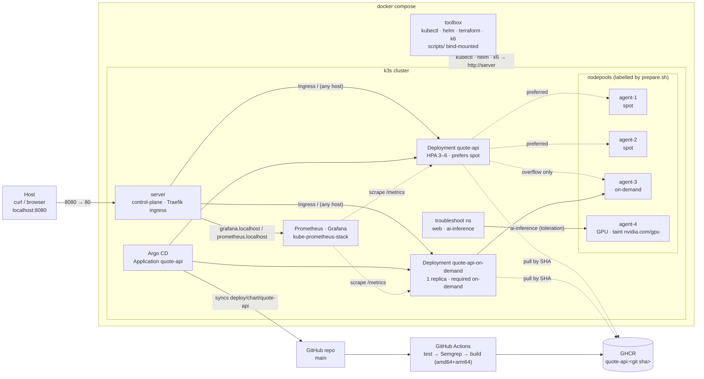
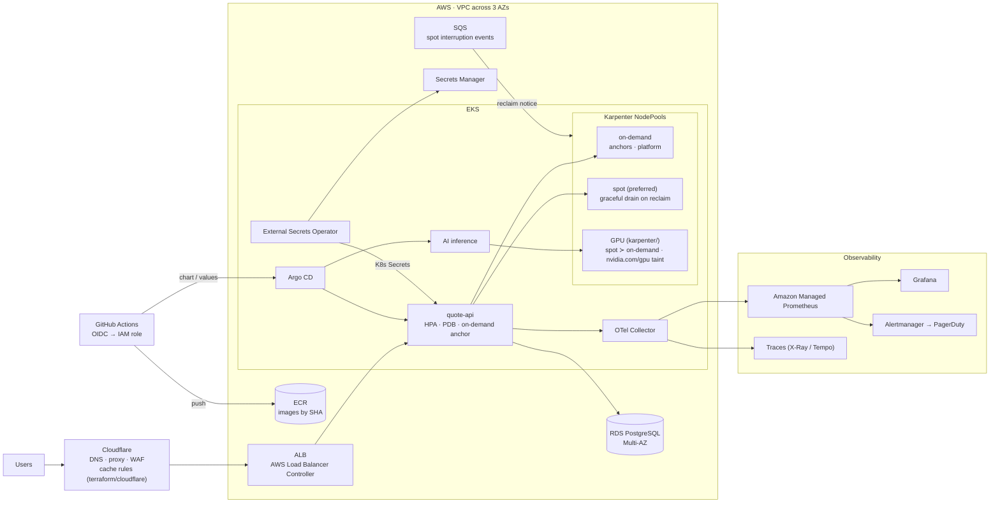

# quote-api — DevOps take-home solution

A quote API on a local 5-node Kubernetes cluster (1 server + 4 agents) in Docker Compose, deployed by Argo CD
from this repo's Helm chart, with spot/on-demand placement and a reclaim drill. It also covers the Part 3
troubleshooting fixes, a GitHub Actions pipeline (Part 4), Karpenter/Cloudflare IaC (Part 5), and load testing
with Prometheus/Grafana (Part 6).

**Every part (4, 5, 6) was done**, plus the AWS production diagram bonus.

## Quick start

```bash
docker compose up -d
./scripts/run-all.sh
```

Then, from the host:

```bash
curl http://localhost:8080/api/quote
```

`scripts/run-all.sh` runs every `scripts/NN-*.sh` inside the `toolbox` container, in order, and stops at the first failure.
The whole run takes about 20 minutes, most of it the Part 6 load test. `docker compose up -d` already runs the node
preparation (`troubleshoot/prepare.sh`) as part of the toolbox bootstrap.

**Requirements:** Docker with privileged containers (Docker Desktop, OrbStack, or Linux), 8 GB RAM for Docker, and host port `8080` free.
Tested on macOS arm64 (OrbStack, 10 CPUs, 8 GB).

**While it runs:** Grafana at <http://grafana.localhost:8080/d/quote-api> (anonymous, read-only) and Prometheus at
<http://prometheus.localhost:8080>. `*.localhost` resolves to `127.0.0.1` in browsers and curl.

> All `kubectl` calls run **inside the toolbox**, against the local k3s API (`https://server:6443`). Nothing reads or
> changes the host's `~/.kube/config`. Don't run `scripts/NN-*.sh` directly on the host: they assume the toolbox.

## Architecture



**Placement (Part 2).** Two Deployments sit behind one Service:

- `quote-api` is the HPA-scaled pool (min 3, max 6). Its required node affinity allows `spot` or `on-demand`, which keeps it
  off the GPU node. A weight-100 preference picks spot, and a **soft** hostname spread (`ScheduleAnyway`, `matchLabelKeys: pod-template-hash`)
  spreads replicas without ever blocking a reschedule when a node disappears.
- `quote-api-on-demand` is a 1-replica anchor with **required** on-demand affinity. Whatever the HPA, a rollout, or a spot reclaim does
  to the pool, one replica is always on on-demand.

Why not one Deployment with a hard topology spread? That was the first design, and it failed live. Spread constraints are checked only
when a pod is scheduled. After an HPA scale-down from 6 to 3, the ReplicaSet deleted the on-demand pods (newest first) and left
all three on spot. Details are in `deploy/chart/quote-api/values.yaml` and `AI-USAGE.md`.

## Script reference

| Script | What it does | When |
|---|---|---|
| `scripts/run-all.sh` (host) | `docker compose up -d`, then every numbered script in the toolbox, then a curl from the host | Once, from the repo root |
| `scripts/10-cluster-prep.sh` | Waits for 5 Ready nodes and runs `troubleshoot/prepare.sh` (spot/on-demand labels, GPU label + taint). Also run by the compose bootstrap | First; idempotent |
| `scripts/20-deploy.sh` | Installs Argo CD (chart 10.10.5, OCI), applies the `quote-api` Application (repo and image derived from `git remote origin` and `HEAD`), waits for Healthy, curls through Traefik | Idempotent |
| `scripts/25-reclaim-drill.sh` | curl loop through Traefik, then cordon + drain the spot node running a replica, show rescheduling, uncordon. Fails on any failed request | After 20; re-runnable |
| `scripts/30-troubleshoot.sh` | Applies `troubleshoot/fixed-app.yaml`, runs the provided `verify.sh` → `PASS` | Part 3 |
| `scripts/50-validate-tf.sh` | `terraform fmt -check`, `init -backend=false`, `validate` (Cloudflare) | Part 5b; no credentials |
| `scripts/60-loadtest.sh` | Installs kube-prometheus-stack, ServiceMonitor, PrometheusRule and dashboard; runs a k6 baseline, then the scale run through the Ingress; records HPA/pod watches and placement; fails unless HPA > 3, thresholds pass, and placement holds. `SKIP_LOADTEST=1` installs monitoring only | Part 6; ~12 min |
| `scripts/lib/common.sh` | Shared helpers (sourced) | — |
| `scripts/lib/toolbox-entrypoint.sh` | Builds the toolbox kubeconfig (`server:6443`), runs node prep, idles | Started by compose |

## Repository layout

```
app/                         Part 1: FastAPI service, tests, multi-stage Dockerfile (non-root, UID 10001)
deploy/chart/quote-api/      Part 2: own Helm chart (2 Deployments, Service, Ingress, HPA, PDB)
deploy/argocd/               Argo CD Application template
deploy/observability/        Part 6: stack values, ServiceMonitor, PrometheusRule, Grafana dashboard JSON
loadtest/                    Part 6: k6 script, Grafana screenshot under load, results/ from the recorded run
troubleshoot/                Part 3: provided files (unchanged) + fixed-app.yaml
karpenter/                   Part 5a: GPU EC2NodeClass + spot/on-demand NodePools
terraform/cloudflare/        Part 5b: proxied DNS record, cache rules, import block
.github/workflows/ci.yml     Part 4: test → Semgrep gate → multi-arch GHCR image
ci/legacy.gitlab-ci.yml      Provided legacy pipeline (reference)
docker-compose.yml           k3s server + 4 agents + toolbox
toolbox/Dockerfile           kubectl 1.31.4, helm 3.16.4, terraform 1.9.8, k6 0.54.0
scripts/                     Numbered tasks, bind-mounted into the toolbox
TROUBLESHOOTING.md · MIGRATION-NOTES.md · LOADTEST.md · OPS-ANSWERS.md · AI-USAGE.md
```

## Design decisions and trade-offs

- **k3s in plain compose services, not the k3d CLI.** The reviewer needs only Docker, and k3d would be one more host binary. The
  agents really are just containers. k3s ships Traefik and kube-router NetworkPolicy enforcement.
- **`cgroup: host` on the k3s containers.** Without it, k3s exits silently on cgroup v2 hosts (most current Docker setups).
  k3s logs go to stdout so a failure shows in `docker compose logs`.
- **No secrets anywhere.** The node join token is generated by the server at runtime and passed through a volume. CI uses
  `GITHUB_TOKEN`; Grafana is anonymous read-only and its admin password is random.
- **Image tag = full git SHA, never `latest`.** CI tags each image with the bare 40-char commit SHA; `20-deploy.sh` deploys the tag for `HEAD`. Built for amd64 and arm64.
- **GitOps from GitHub, not from the local checkout.** Argo CD clones the public repo. That's the point of GitOps, and it is why
  the deployed commit has to be on GitHub with its image on GHCR (CI does that on every push to `main`).
- **Argo CD and the monitoring stack are installed with Helm, not with Argo.** They're the platform the app is delivered onto. The app itself
  is only ever deployed by Argo CD. Argo ignores `/spec/replicas` on the HPA-managed Deployment so self-heal doesn't fight the HPA.
- **OCI Helm charts.** The classic repo indexes are 1.6 MB (Argo) and 6.5 MB (prometheus-community) and took 30–70 s to download here; OCI pulls take seconds.
- **Monitoring trimmed for 8 GB.** No Alertmanager (the rule is visible as an alert in Prometheus), no node-exporter, and k3s-embedded
  control-plane scrape targets disabled (they don't exist on k3s and would only produce permanent alerts).
- **Semgrep, not SonarQube.** No server or token needed, and `--error` makes it a real gate. 0 findings on the current code.
- **Cut:** Trivy and cosign (Part 4 bonus), OpenTelemetry tracing, and Alertmanager routing. They're useful but not needed to show the
  parts asked for, and they'd add more to break on a reviewer's machine.

## Production on AWS (bonus)

The same chart and placement model; nodepools become Karpenter NodePools.



Differences from the local setup: the ALB replaces Traefik; Karpenter provisions nodes instead of fixed agents; spot reclaims
arrive through the SQS interruption queue so pods drain before the instance goes; CI authenticates to AWS with OIDC (no static
keys); secrets come from Secrets Manager via ESO (`OPS-ANSWERS.md` Q4).

## Troubleshooting notes (reviewer machine)

1. **`run-all.sh` hangs at "waiting for nodes".** Run `docker compose logs server | tail -30`. A cgroup error means Docker
   doesn't allow `cgroup: host` or privileged containers (rootless Docker, some corporate Docker Desktop policies); use a standard
   Docker install. To start over: `docker compose down -v && docker compose up -d`.
2. **Port 8080 is taken.** Change `"8080:80"` in `docker-compose.yml` and the `curl` line in `scripts/run-all.sh`.
3. **Out of memory / pods `Pending` with `Insufficient memory`.** The full stack (5 nodes, Argo CD, Prometheus, Grafana) needs about 6–7 GB.
   Raise the Docker VM memory, or run `SKIP_LOADTEST=1` if only the monitoring install is needed.
4. **`quote-api` pods `ImagePullBackOff`.** The image for the checked-out commit isn't on GHCR yet (CI still running), or the
   checkout is not on a commit that was pushed to `main`. Wait for the `ci` workflow, or `git checkout main`, then rerun `scripts/20-deploy.sh`.
5. **Slow first run.** Images are pulled onto the nodes the first time (k3s, Argo CD, Prometheus, Grafana, nginx, quote-api). On a slow
   link the quote-api image alone took 2–4 minutes per node here. `20-deploy.sh` prints progress and waits up to 30 minutes; later runs reuse the pulled images.
6. **`50-validate-tf.sh` is slow the first time.** `terraform init` downloads the 43 MB Cloudflare provider from GitHub's release CDN
   (on a slow link here, ~58 KB/s, that was ~12 minutes). It is cached in the `tfcache` volume, so later runs take seconds. It isn't hung.

## Status

Every script was run end to end from a fresh clone of this public repo (details and limits in "What was verified, and what wasn't" in
`AI-USAGE.md`). Not run: the Karpenter manifests (no EKS here) and a real Cloudflare `plan`/`apply`; both are validate-only by design.
